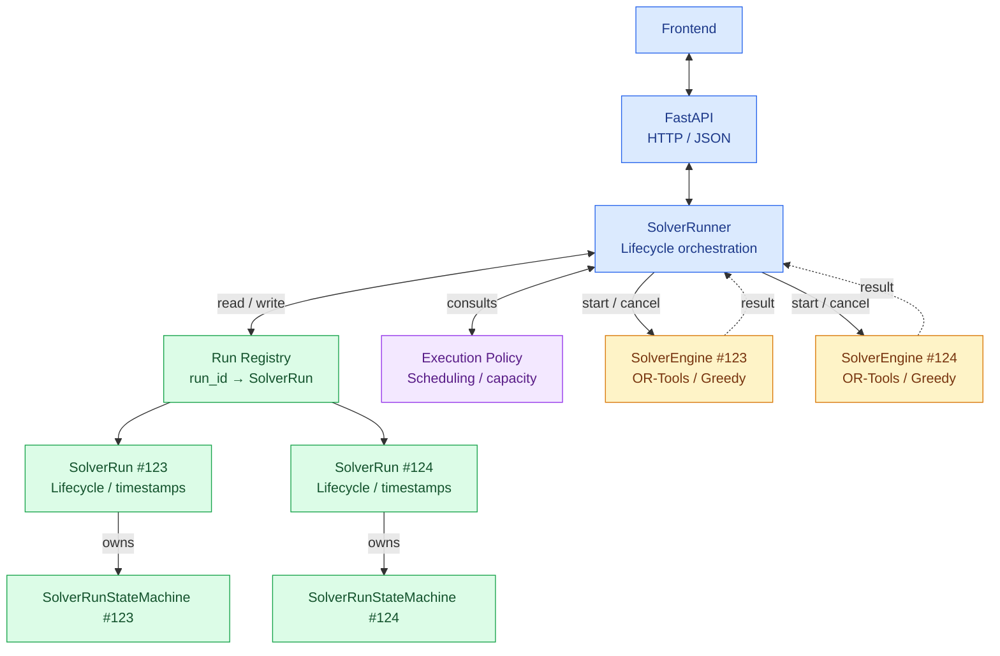
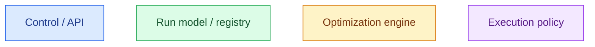
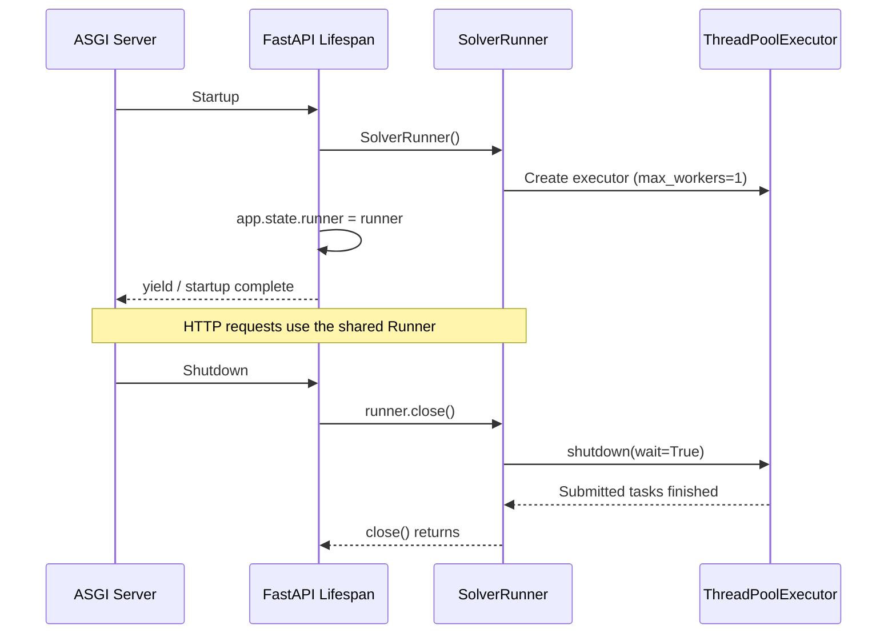
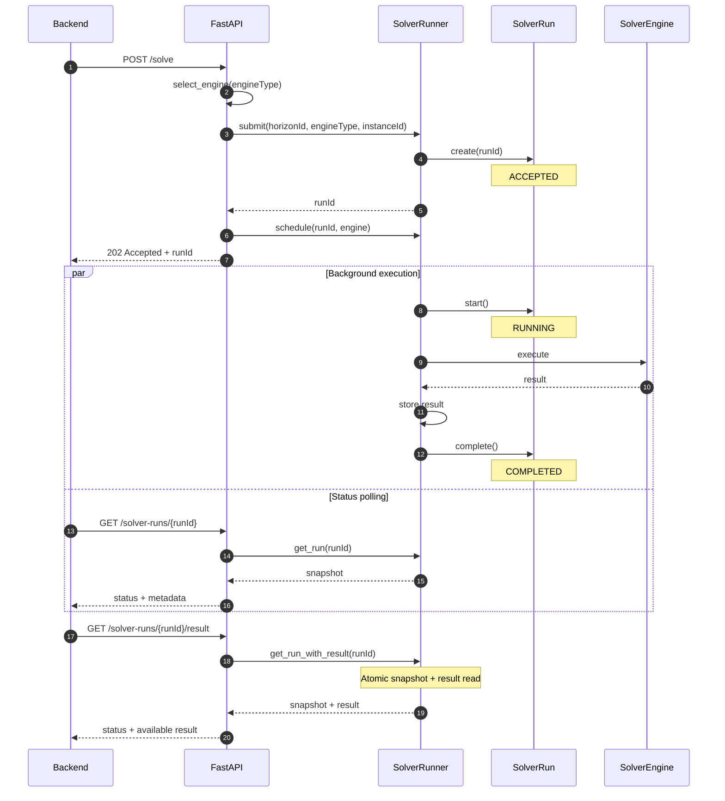

# Solver lifecycle architecture

## Requirements view

The important responsibility and ownership relations are:

- `SolverRun` owns its `SolverRunStateMachine` and lifecycle timestamps.
- `SolverRunStateMachine` validates state transitions; it neither measures time nor initiates calculations.
- `SolverRun` records event timestamps, but does not measure execution durations or run optimization itself.
- `SolverRunner` coordinates runs, their lifecycle events and execution resources.
- `SolverEngine` performs the actual optimization (OR-Tools CP-SAT or the required greedy baseline).
- The Engine's computational result and the `SolverRun` lifecycle state are distinct concepts.

## Extended logical architecture

### Legend

Solid arrows show coordination, access or ownership as indicated by their labels. Dashed arrows from the Engines represent results or termination information returned to the Runner; they do **not** prescribe callbacks, threads or processes.

### Architecture notes

- **Decided responsibility split:** The Runner coordinates lifecycle events; the `SolverRun` owns its state machine and timestamps; the Engine performs calculations. The Engine must not directly mutate the `SolverRun` lifecycle.
- **Logical components, not necessarily classes:** The Run Registry and Execution Policy express responsibilities of the Runner. Whether to implement them as separate Python classes remains open.
- **Illustrative instances:** Runs `#123` and `#124` and the two Engine boxes illustrate multiple jobs and executions. They neither require a permanent one-to-one Run–Engine ownership relation nor imply simultaneous optimization.
- **Capacity and scheduling:** The initial implementation serializes Engine execution with a single-worker ThreadPoolExecutor. Parallel execution, cancellation coordination and resource limits remain future design decisions.
- **Deployment:** The initial implementation uses one Runner and one in-memory Registry per FastAPI application process, with a single Uvicorn worker assumed. Shared-state coordination for multi-worker deployment remains an open architectural extension.
- **Result ownership:** The SolverRunner owns an in-memory result store keyed by runId. Engines return their computational results to the Runner, which stores independent copies. External callers receive independent result copies; mutable internal storage is never exposed.

### FastAPI application lifecycle and Runner ownership

**Requirement:** `D06.SOLV.0007`  
**Implementation:** `app/main.py`, `app/solver/runner.py`  
**Verification:** `tests/test_health.py::test_runner_lifecycle`

The FastAPI application owns one SolverRunner through its lifespan
context manager.

- Startup creates a SolverRunner and stores its reference in
  `app.state.runner`.
- HTTP handlers access the application-owned Runner rather than
  creating independent Runner instances.
- Normal lifespan shutdown invokes `runner.close()`.
- `SolverRunner.close()` calls `ThreadPoolExecutor.shutdown(wait=True)`,
  waiting for submitted execution tasks to finish.
- Closing the Runner does not imply Python object destruction.

#### Deployment boundary

The initial implementation assumes one Uvicorn worker process.

Each independent application process would create its own Runner,
Registry, lock, and executor. The current in-memory Registry does
not provide cross-process admission protection or run lookup.

Multi-worker deployment requires an explicitly designed shared-state
and coordination mechanism before it can be supported.

#### Current verification boundary

The lifecycle test verifies Runner creation and availability
during startup and exactly one `close()` invocation during shutdown.

The test executes the original close implementation through a
mock spy. It does not independently verify forced process termination,
multi-worker coordination, or shutdown behavior under long-running
solver computations.

### Runner registration and admission

The SolverRunner provides the following run registration and lookup operations:

- `submit(horizon_id, engine_type, instance_id) -> run_id`
- `get_run(run_id) -> SolverRunSnapshot | None`
- `get_run_with_result(run_id) -> tuple[SolverRunSnapshot, list[dict[str, str]] | None] | None`

`get_run_with_result()` reads the snapshot and result atomically under the Runner's RLock and returns a deep copy of the result. Result availability is independent of lifecycle state.

The current result format is temporary; Chapter 7.2 Solution JSON remains pending.

Admission is serialized by a Runner-owned lock.

Each admitted run is associated with one horizon identifier and
one engine type. Multiple non-terminal runs with the same
(horizon_id, engine_type) pair are rejected.

Each registered run retains its `horizon_id`, `engine_type`,
and `instance_id` as Runner-owned metadata.

The active-run admission key remains `(horizon_id, engine_type)`.
Different instance identifiers do not bypass this restriction.

`get_run()` exposes `instance_id` through an immutable
`SolverRunSnapshot`, without exposing mutable SolverRun objects.

Runs in terminal states remain queryable and do not prevent
resubmission for the same pair.

The Runner retains ownership of mutable SolverRun objects and
exposes immutable snapshots to callers.

The current implementation provides run registration, immutable status
snapshots, serialized execution scheduling, and in-memory result
retention.

The Dummy Engine is integrated at the execution layer using an
injectable roster provider. The production roster provider and
the complete Ch 7.2 solution format remain pending.

### Serialized execution – initial implementation

The SolverRunner uses a ThreadPoolExecutor with one worker
to execute scheduled Solver runs.

- `submit()` registers a run without starting execution.
- `schedule(run_id, engine)` submits an engine callable for execution.
- A queued run remains in ACCEPTED state.
- The Runner changes the state to RUNNING when execution begins.
- Successful execution stores the returned result and completes the run.
- An Engine exception results in FAILED state.

Engine implementations do not own or mutate SolverRun lifecycle state.

Engine selection is performed outside SolverRunner using the requested
`engineType`. The HTTP layer passes the selected Engine callable to
SolverRunner for scheduling; the Runner remains Engine-agnostic.

Cancellation, timeout, detailed failure reporting, resource limits,
and the final Engine contract remain pending.

## Runtime interaction — proposed successful run

The sequence illustrates a successful asynchronous run using the implemented
POST /solve and Runner execution flow. The status GET endpoint is implemented;
the result GET endpoint remains proposed.

### Timestamp semantics

- `accepted_at`: time at which the run is accepted and registered.
- `started_at`: time at which the run transitions successfully to `RUNNING`.
- `finished_at` : time at which the run successfully enters a terminal lifecycle state, rather than the Engine's exact computation-stop time.
- These timestamps are UTC `datetime` values. Durations and solver statistics can be evaluated separately; the Engine may expose its own computation timing.

The diagram shows successful completion only. Cancellation, timeouts, failure handling and any waiting queue require separate decisions and tests.

